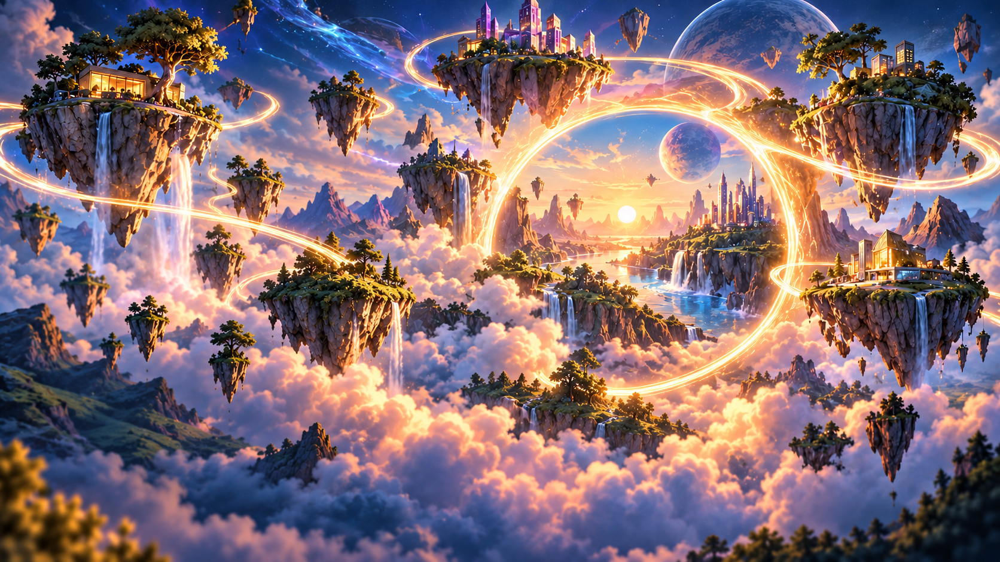

# Approved floating-islands homepage background

**Approved:** 21 October 2026, DaveHub / DH-01N.

## Master artwork

- **PNG master:** [floating-islands-background.png](../assets/homepage/floating-islands-background.png), 1672 × 941 pixels, full-colour RGB.
- **Faithful SVG:** [floating-islands-background.svg](../assets/homepage/floating-islands-background.svg). Embeds the PNG byte-for-byte for the same visual appearance. **Not a true vector drawing.**
- **Backup:** [Google Drive original](https://drive.google.com/file/d/1va5nh4ZJDiyUz9ET3X6jJ2G6Zf75PR8t/view).
- **PNG SHA-256:** `b7ef95c6d731451ef0def7702b24fbb3e69e59ffb6b5b6f923b483dc4ba259ec`.

## Usage

This is the approved **background plate only**: floating islands, luminous routes, waterfalls, clouds, sunset and planets. No Dave character, logo, category labels, interactive controls or other baked-in page elements.

Implement the illustrated Dave host, approved DaveHub logo, navigation and CTA as **independent layers and real HTML controls** over this image. Do not use a flattened screenshot of the prototype as a clickable interface.

The SVG is a self-contained format wrapper, not a scalable repaint. For the production website, prefer properly optimised responsive raster variants or an image-set from the unchanged master; keep CSS aspect/crop responsive and ensure foreground text has adequate contrast.

This asset approval does not lock exact mobile cropping, typography, positions or animation. Those remain within DH-01A. Keep the approved originals unchanged and make any refinements as separate revisions.
