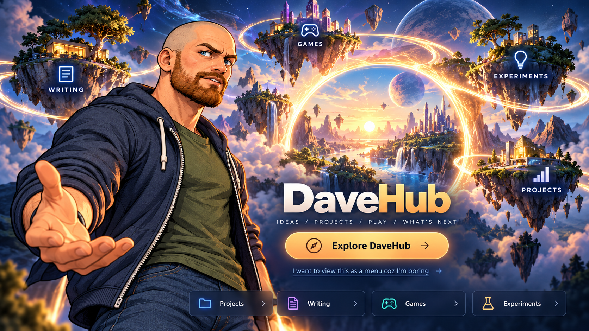
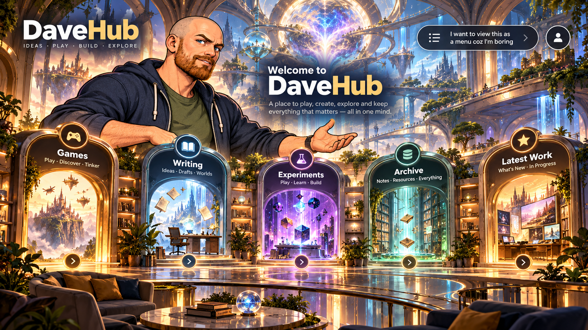
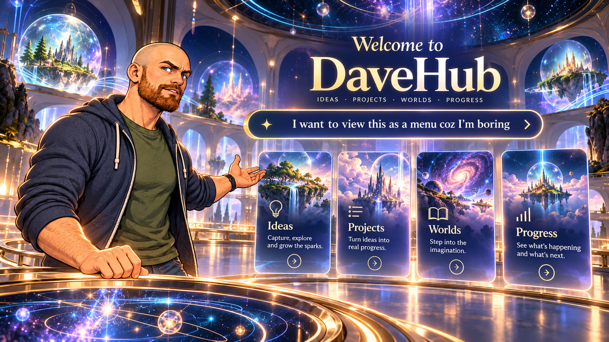

# DaveHub — Approved core visual reference gallery

**Approved:** 21 October 2026. **Status:** Concept direction LOCKED for ongoing design exploration, not final production assets.

**Primary choice is Concept 1.** The other two are useful supporting expressions of the *same* style.

## 01 — Floating islands / Explore DaveHub (PRIMARY)

- **Preferred:** Main landing mood, David character look, imaginative connected world, visual richness and prominent Explore action.
- **Menu link:** The mock-up already contains the owner's preferred phrase.
- **Still flexible:** Final UI positions, fonts, labels, lighting, animation and any exact copy except the intentionally specified menu phrase.
- **Original PNG:** [01-floating-islands-home.png](../assets/concepts/2026-10-21/01-floating-islands-home.png)
- **Google Drive original:** [concept-01-explore-davehub.png](https://drive.google.com/file/d/1BrEdUguS-sAGm8tWcDDGJkmySmxYKBSI/view)

## 02 — Portal hall / thematic destinations (SUPPORTING)

- Use as a reference for clear category entrances and animated project-space transitions.
- Do not automatically replace Concept 1 as the homepage.
- **Original PNG:** [02-portal-hall.png](../assets/concepts/2026-10-21/02-portal-hall.png)
- **Google Drive original:** [concept-02-portal-hub.png](https://drive.google.com/file/d/1BtSQKmQVDIaXR2jAAcC_8pLWDuGkfZP0/view)

## 03 — Observatory / interface elements (SUPPORTING)

- Use for interface grammar, central mind-machine areas, search/index integration, atmospheric observatory machinery.
- Do not treat the slick panels shown here as the final **boring menu** design: the actual fallback must be intentionally 1990s, basic HTML.
- **Original PNG:** [03-observatory-menu.png](../assets/concepts/2026-10-21/03-observatory-menu.png)
- **Google Drive original:** [concept-03-observatory-menu.png](https://drive.google.com/file/d/1AEKKam4KcbFq31P3rf_83JwhlzFhqwtH/view)

## Hard agreed interactions

- **No tiny avatars walking around.** Exploration = click/tap to enter scenes and destinations.
- A large illustrated Dave is the host, not the playable visitor avatar.
- Visible control: **"I want to view this as a menu coz I'm boring"**.
- The alternative actually changes to an old-school basic HTML site with blue links and no fancy presentation, sharing the exact same underlying content.
- Optional introduction and direct project links.
- No Terry Gilliam-style cut-out animation, collage, grotesque surrealism or default steampunk.

## Preservation

- All three unchanged, full-resolution original PNG images are committed as Git blobs under `assets/concepts/2026-10-21/`.
- Matching PNG backups are in the owner's Google Drive `DaveHub` folder.
- Treat this gallery as the starting point when generating or reviewing new site art.
- These are image references, not editable layers or final interactive website assets.
